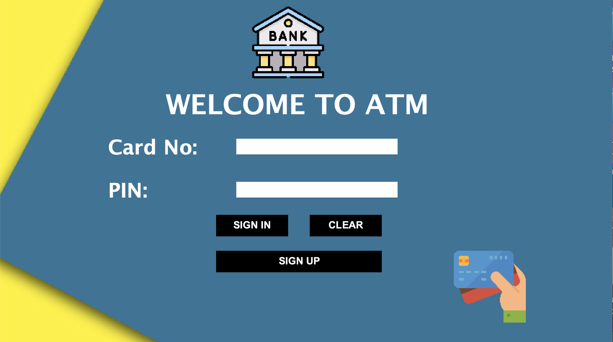
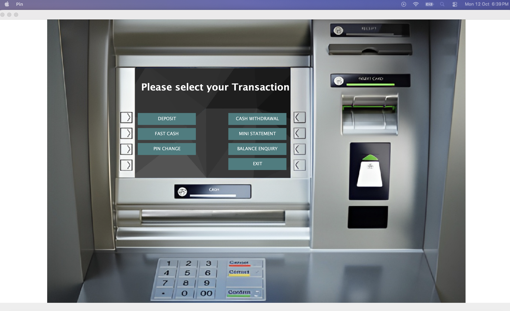
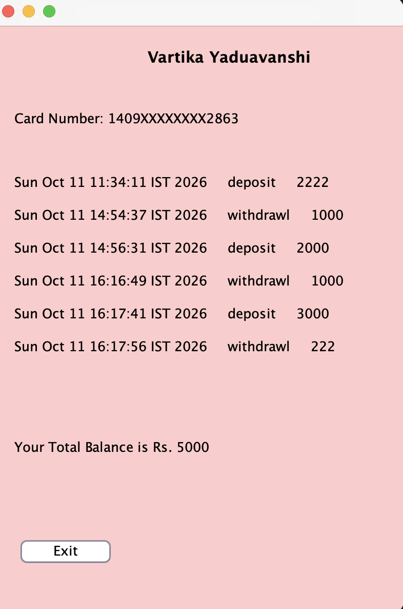

# 🏦 Bank Management System

A desktop ATM and banking application built with **Java Swing** and **JDBC**. Users can sign up, log in with a card number and PIN, and perform everyday banking operations through a GUI.


## 📸 Screenshots

| Login | Dashboard | Transactions |
|---|---|---|
|  |  |  |

## ✨ Features

- **Account signup** with multi-step form (personal, additional, and account details)
- **Secure login** using card number and PIN
- **Deposit** and **withdraw** cash
- **Fast cash** for quick preset withdrawals
- **Balance enquiry**
- **Mini statement** showing recent transactions
- **PIN change**
- [ ] Input validation and error handling for invalid card, PIN, or amount

## 🛠️ Tech Stack

| Layer | Technology |
|---|---|
| Language | Java |
| GUI | Swing, AWT |
| Database | MySQL |
| Connectivity | JDBC |
| IDE | IntelliJ IDEA |

## 🧠 Concepts Demonstrated

- Object-oriented design (inheritance, encapsulation, packages)
- Event-driven programming with `ActionListener`
- JDBC for CRUD operations on a relational database
- Exception handling
- Absolute-positioned Swing layouts and custom image assets

## 📁 Project Structure

```
bank-management-system/
├── src/
│   └── bank/management/system/
│       ├── Login.java
│       ├── Signup.java
│       ├── Transactions.java
│       ├── Deposit.java
│       ├── Withdrawl.java
│       ├── BalanceEnquiry.java
│       ├── MiniStatement.java
│       ├── PinChange.java
│       └── Conn.java          # DB connection
├── icon/                      # UI images
└── README.md
```

## 🚀 Getting Started

### Prerequisites
- JDK 17 or higher
- MySQL Server
- MySQL Connector/J (JDBC driver)

### 1. Clone the repo
```bash
git clone https://github.com/<your-username>/<repo-name>.git
cd <repo-name>
```

### 2. Set up the database
```sql
CREATE DATABASE bankmanagementsystem;
USE bankmanagementsystem;
-- add your CREATE TABLE statements here (signup, login, bank, ...)
```

### 3. Configure the connection
In `Conn.java`, update your credentials:
```java
DriverManager.getConnection("jdbc:mysql://localhost:3306/bankmanagementsystem", "root", "your_password");
```

### 4. Run
Add the MySQL Connector JAR to your project libraries, then run `Login.java`.

## 🔐 Known Limitations / Future Improvements

- Hash PINs (e.g., BCrypt) instead of storing plain text
- Use `PreparedStatement` everywhere to prevent SQL injection
- Move DB credentials to a config file or environment variables
- Add unit tests and a proper layered architecture (DAO/service)
- Migrate UI to JavaFX or a web frontend

## 🙌 My Contributions

- [ ] What you changed or added beyond the tutorial (e.g., fixed UI bugs, added validation, improved structure)

## 📚 Credits

Built while following [this tutorial series](https://www.youtube.com/watch?v=Qe2LBPIQOyE&list=PLbKub4Jss9oVSgCL6pFsiq0NLluRCDOdU&index=1).

## 👤 Author

**Aryan**
- GitHub: [@your-username](https://github.com/your-username)
- LinkedIn: [your-profile](https://linkedin.com/in/your-profile)
